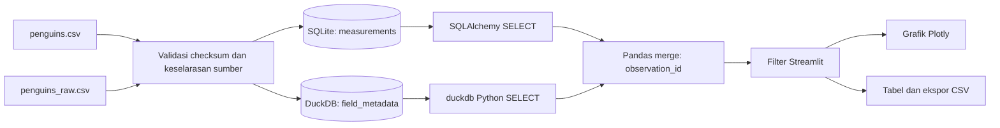

# Palmer Observatory

**Dashboard interaktif penelitian penguin Antarktika dengan pipeline dua DBMS.**

Tugas Mandiri Terstruktur - Multi-DBMS Data Pipeline & Web Visualization dengan Python.

| Identitas | Keterangan |
|---|---|
| Nama | Mohamad Rizal Rahmadi |
| NIM | 230660121114 |
| Program studi | Informatika |
| Mata kuliah | Visualisasi Data dan Informasi |
| Dosen | Irfan Fadil |

## Tautan utama

- Repositori: https://github.com/Jayouss/palmer-observatory
- Aplikasi live: https://palmer-observatory.streamlit.app/
- Laporan: [Laporan implementasi (PDF)](docs/Laporan_VDI_Mohamad_Rizal_Rahmadi.pdf)
- Sumber resmi: https://allisonhorst.github.io/palmerpenguins/
- Dataset pengukuran: https://github.com/allisonhorst/palmerpenguins/blob/main/inst/extdata/penguins.csv
- Dataset metadata: https://github.com/allisonhorst/palmerpenguins/blob/main/inst/extdata/penguins_raw.csv

## 1. Studi kasus dan tujuan

Tim pemantauan ekologi ingin menelaah perbedaan morfologi dan komposisi sampel penguin di Kepulauan Palmer. Pertanyaannya: bagaimana sebaran massa tubuh antarspesies, bagaimana hubungan ukuran sirip dengan massa tubuh, dan bagaimana komposisi observasi menurut pulau serta tahun?

SQLite menyimpan catatan pengukuran individu sebagai data operasional. DuckDB menyimpan arsip metadata lapangan seperti studi, identitas individu di lapangan, tahap reproduksi, tanggal telur, dan isotop. Pemisahan tanggung jawab ini mendemonstrasikan integrasi database operasional dan arsip analitik. Pada 344 baris, dua engine tidak diperlukan untuk performa; pilihan ini bertujuan memenuhi dan menjelaskan arsitektur multi-DBMS.

## 2. Arsitektur

SQLite dan DuckDB merupakan **dua engine DBMS berbeda**, bukan dua tabel atau dua file dari engine yang sama. Keduanya berjalan embedded dalam proses aplikasi, sehingga deployment tidak membutuhkan layanan database berbayar atau kredensial remote.



| DBMS | Tabel | Isi | Jumlah |
|---|---|---|---:|
| SQLite | `measurements` | Spesies, pulau, tahun, jenis kelamin, empat ukuran tubuh | 344 |
| DuckDB | `field_metadata` | Studi, sampel, nama ilmiah, metadata reproduksi, isotop, komentar | 344 |

Skema lengkap ada pada `database/schema_sqlite.sql` dan `database/schema_duckdb.sql`. Keduanya menetapkan `observation_id` sebagai primary key; skema SQLite juga membatasi tahun, jenis kelamin, dan nilai pengukuran positif.

## 3. Alur integrasi dan reproduksibilitas

1. Dua CSV asli disertakan di `data/raw/`. Aplikasi tidak membutuhkan unduhan saat startup.
2. `manifest.json` mencatat URL, tanggal pengambilan, dan SHA-256 setiap berkas.
3. Seed memeriksa checksum, jumlah 344 baris, dan kesamaan pengukuran, pulau, spesies, tahun, serta jenis kelamin antarsumber.
4. Setelah korespondensi baris terbukti, nomor urut sumber 1-344 menjadi `observation_id`. ID ini adalah kunci teknis proyek, bukan nomor identitas biologis atau nomor sampel asli. Nomor sampel asli tidak dipakai sebagai kunci global karena dapat berulang antarstudi/spesies.
5. Pengukuran dimasukkan ke SQLite; metadata dimasukkan ke DuckDB. Seed membangun ulang file dari sumber secara deterministik, tanpa menambah duplikasi.
6. `pipeline.py` mengeksekusi dua kueri melalui konektor yang berbeda, lalu melakukan `measurements.merge(metadata, on='observation_id', how='left', validate='one_to_one', indicator=True)`.
7. Pipeline memeriksa jumlah baris, kelengkapan pasangan metadata, serta kesamaan pulau. Kegagalan validasi menghentikan pemuatan; tidak ada fallback CSV yang menyamarkan kegagalan DBMS.
8. Filter dijalankan setelah join, kemudian hasil digunakan untuk KPI, grafik, tabel, dan CSV.

ID berbasis urutan hanya aman untuk snapshot tervalidasi ini. Penggantian sumber harus disertai pembaruan manifest dan validasi ulang, bukan langsung menggabungkan file yang urutannya berbeda.

## 4. Fitur aplikasi

- Filter spesies, pulau, rentang tahun, jenis kelamin, dan kelengkapan morfologi.
- KPI jumlah observasi, jumlah spesies, rerata massa tubuh, serta persentase morfologi lengkap.
- Scatter dengan pemilihan kedua sumbu, simbol spesies, tooltip, dan zoom.
- Diagram batang komposisi spesies, box plot massa tubuh, komposisi pulau, dan sampel tahunan.
- Tabel hasil integrasi dan unduhan CSV yang mengikuti filter.
- Audit nilai kosong dan penjelasan metode/sitasi di dalam aplikasi.
- Kondisi filter kosong ditangani dengan pesan yang jelas.

## 5. Data, kualitas, dan interpretasi

Snapshot memuat 344 observasi: Adelie 152, Chinstrap 68, Gentoo 124; tahun 2007-2009; pulau Biscoe, Dream, dan Torgersen. Empat variabel morfologi masing-masing kosong pada 2 observasi; 342 observasi memiliki keempat ukuran. Jenis kelamin kosong pada 11 observasi dan diberi label `unknown`. Nilai kosong lain tetap dipertahankan.

Rerata dihitung dari nilai tersedia, tanpa imputasi. Scatter menghilangkan baris kosong hanya untuk dua sumbu yang dipilih; jumlah baris yang digunakan ditampilkan. Tombol morfologi lengkap tidak otomatis mengharuskan jenis kelamin terisi. Persentase morfologi lengkap menggunakan seluruh observasi setelah filter sebagai penyebut.

Hasil deskriptif seluruh data:

| Spesies | n observasi | n massa tersedia | Rerata massa (g) |
|---|---:|---:|---:|
| Adelie | 152 | 151 | 3700,66 |
| Chinstrap | 68 | 68 | 3733,09 |
| Gentoo | 124 | 123 | 5076,02 |

Gentoo memiliki rerata massa lebih tinggi pada sampel ini. Rerata keseluruhan adalah 4201,75 g dari 342 pengukuran. Temuan tersebut bukan bukti kausal dan tidak dapat langsung digeneralisasikan ke seluruh penguin. Jumlah observasi per tahun bukan estimasi populasi; distribusi sampel dapat dipengaruhi lokasi, spesies, jenis kelamin, dan desain penelitian. Data historis ini bukan pemantauan kondisi terkini.

## 6. Menjalankan secara lokal

Gunakan Python 3.12 dan jalankan dari folder proyek:

```bash
python -m venv .venv
# Windows PowerShell
.venv\Scripts\Activate.ps1
# macOS/Linux: source .venv/bin/activate
python -m pip install -r requirements.txt
python -m database.seed_data
python -m streamlit run app.py
```

Seed juga dijalankan otomatis apabila file database belum ada. File hasil ada di `data/generated/` dan tidak masuk Git. Untuk mengubah lokasinya, atur environment variable `PALMER_DATA_DIR` ke direktori yang boleh ditulis oleh aplikasi. Tidak ada password yang di-hardcode; engine lokal tidak memerlukan username/password. Jika kelak menggunakan layanan remote, simpan kredensial di environment variables atau Streamlit Secrets, bukan di repositori.

## 7. Deployment Streamlit Community Cloud

1. Masuk https://share.streamlit.io dengan akun GitHub pemilik repositori.
2. Buat aplikasi dari repositori `Jayouss/palmer-observatory`, branch `main`, main file `app.py`.
3. Pilih Python **3.12** di pengaturan lanjutan.
4. Deploy dan tunggu instalasi dependensi selesai. File database dibuat dari CSV dalam repositori pada startup.
5. Pastikan akses aplikasi **publik**, lalu uji URL melalui jendela tanpa login. Periksa KPI 344 observasi, tiga spesies, dan filter Gentoo yang menghasilkan 124 observasi.
6. Catat URL sebenarnya di `docs/submission.json` dan `PENGUMPULAN.md`.

Penyimpanan lokal Community Cloud bersifat sementara. Hal ini ditangani dengan seed otomatis dari sumber yang disertakan. Aplikasi merupakan dashboard baca saja, bukan layanan untuk menyimpan entri pengguna. Repositori sudah menyediakan `.streamlit/config.toml` dan dependensi dengan versi tetap.

Alternatif Hugging Face Spaces: buat Docker Space dengan port 7860, unggah isi repositori, dan gunakan `Dockerfile` yang tersedia. Akun layanan hosting tetap harus disiapkan pemilik.

## 8. Pengujian

```bash
python -m pip install -r requirements-dev.txt
python -m pytest -q
```

Pengujian memeriksa keselarasan sumber, hasil join 344 baris, primary key dan seed ulang, filter dan missing values, penolakan metadata tidak lengkap/salah pulau, serta dashboard menggunakan Streamlit AppTest. Workflow GitHub Actions tersedia pada `.github/workflows/tests.yml`.

## 9. Struktur proyek

```text
app.py                     Antarmuka Streamlit dan grafik Plotly
pipeline.py                Kueri dua DBMS, join, dan filter
requirements.txt           Dependensi aplikasi
database/
  schema_sqlite.sql        DDL pengukuran
  schema_duckdb.sql        DDL metadata lapangan
  seed_data.py             Validasi dan seed kedua DBMS
data/raw/
  penguins.csv             Data pengukuran asli
  penguins_raw.csv         Data mentah asli
  manifest.json            Provenans dan checksum
tests/                     Uji integrasi dan aplikasi
docs/                      Status publikasi dan laporan
.streamlit/config.toml     Tema dan konfigurasi
Dockerfile                 Opsi hosting Docker
PENGUMPULAN.md             Ringkasan untuk form LMS
```

## 10. Sitasi data dan referensi kode

**Data:** Horst, A. M., Hill, A. P., & Gorman, K. B. (2020). *palmerpenguins: Palmer Archipelago (Antarctica) penguin data*. https://allisonhorst.github.io/palmerpenguins/ . Data dikumpulkan oleh Dr. Kristen Gorman dan Palmer Station LTER, tersedia dengan lisensi **CC0**; atribusi dipertahankan sebagai praktik akademik.

**Penelitian primer:** Gorman, K. B., Williams, T. D., & Fraser, W. R. (2014). Ecological Sexual Dimorphism and Environmental Variability within a Community of Antarctic Penguins (Genus Pygoscelis). *PLOS ONE, 9*(3), e90081. https://doi.org/10.1371/journal.pone.0090081

**Rujukan teknik dan repositori:**

| Referensi | Bagian yang dipelajari |
|---|---|
| https://github.com/streamlit/streamlit | Widget, cache data, layout, AppTest |
| https://github.com/plotly/plotly.py | Scatter, bar, box plot, tooltip |
| https://github.com/sqlalchemy/sqlalchemy | Engine/koneksi dan kueri SQLite |
| https://github.com/duckdb/duckdb | Koneksi Python, SQL dan konversi DataFrame |
| https://github.com/pandas-dev/pandas | Merge satu-ke-satu dan agregasi |
| https://github.com/allisonhorst/palmerpenguins | Sumber data dan konteks visualisasi morfologi |

Kode aplikasi disusun khusus untuk proyek ini dengan bantuan AI. Repositori di atas merupakan rujukan penggunaan pustaka; tidak ada klaim bahwa implementasi ini menyalin contoh tertentu. Mahasiswa perlu memahami alur dan hasil sebelum pengumpulan.
